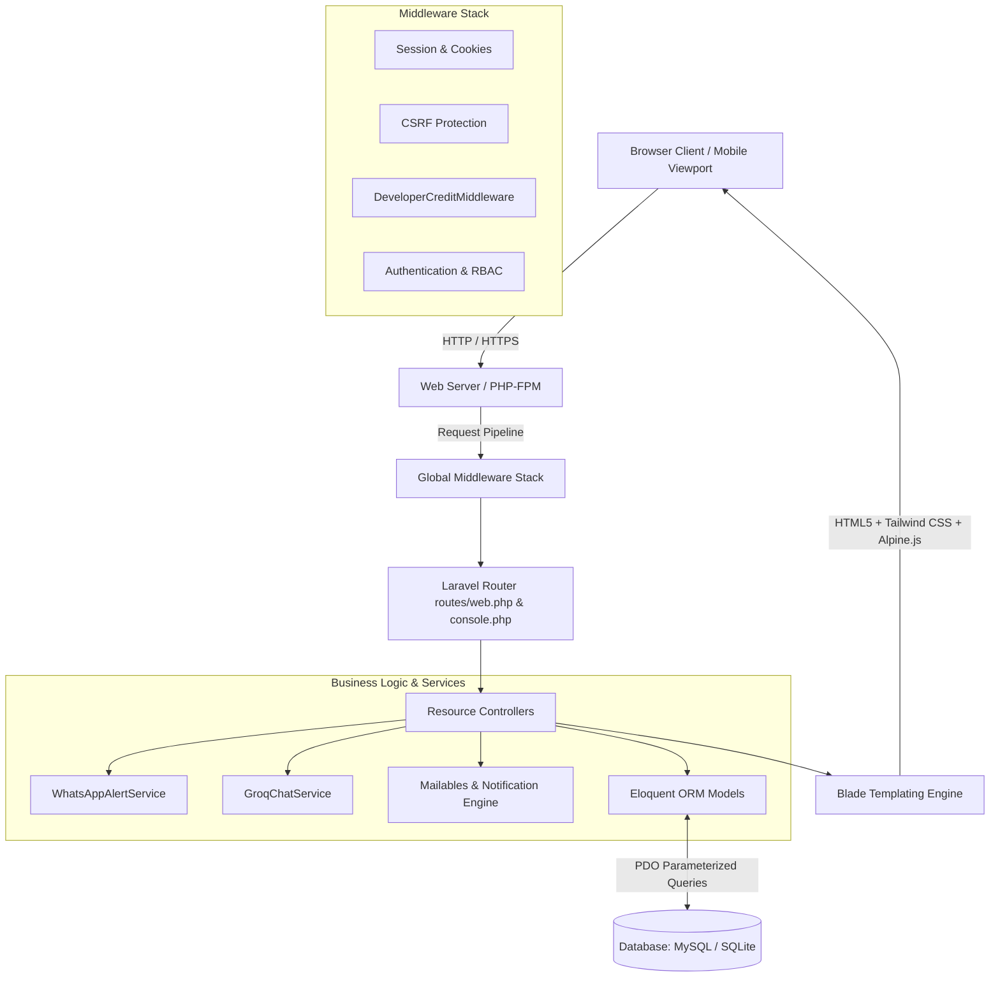
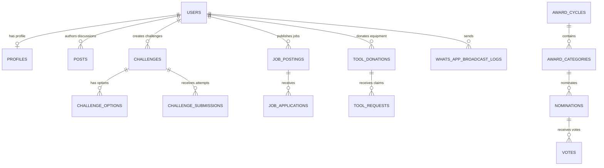

# System Architecture Document: K. D. Polytechnic Alumni Portal

**Document Version:** 2.0.0 (Production Architecture)  
**Lead Software Architect & Engineer:** **Sindhi Shahejad**  
**Institution:** K. D. Polytechnic, Patan (Estd. 1961)  
**Date:** October 29, 2026  

---

## 1. Architectural Overview & Design Pattern

The **K. D. Polytechnic Alumni Portal** is engineered as a robust, monolithic web application adhering strictly to the **Model-View-Controller (MVC)** pattern, augmented with a dedicated **Domain Services Layer** in **Laravel 11 (PHP 8.2+)**.

---

## 2. Layered Architecture Breakdown

### 2.1 Presentation Layer (Frontend)
* **Blade Templating Engine:** Component-driven hierarchical layouts (`layouts/app.blade.php`, `layouts/guest.blade.php`).
* **Tailwind CSS 3.x:** Utility-first styling reverse-engineered to mirror official KDP Patan colors:
  * Primary Navy: `#1e3a8a` / `#0f2042`
  * Accent Saffron: `#f97316` / `#ea580c`
  * Royal Blue: `#3b82f6`
* **Alpine.js 3.x:** Declarative, lightweight client-side reactivity for modals, dropdowns, live preview mockups, search modals, and dynamic challenge forms without heavy SPA overhead.
* **Leaflet Geographic Maps:** Interactive Gujarat and worldwide chapter maps rendered with custom pins and zero attribution watermark clutter.

### 2.2 Controller & Service Layer (Backend)
* **Resource Controllers:** Encapsulate HTTP request validation, business logic, authorization checks, and view responses.
* **Domain Services:**
  1. **`WhatsAppAlertService`:** Handles international E.164 phone sanitization (`+91`), encodes universal `wa.me` instant dispatch URLs, integrates optional Meta Cloud API HTTP requests, and logs all dispatches to `WhatsAppBroadcastLog`.
  2. **`GroqChatService`:** Provides high-speed conversational AI inference via Groq Cloud API, configured without restrictive guardrails to ensure helpful, edge-case coverage for students and alumni.
  3. **`AdminAlertController`:** Orchestrates multi-channel broadcast generation, targeting filters (by branch, batch year, or individual number), and SMTP test emails.

### 2.3 Global Middleware Pipeline
* **`AdminMiddleware`:** Protects administrative routes, verifying `is_admin` status.
* **`DeveloperCreditMiddleware`:** Attaches technical authorship headers to every HTTP response across the whole portal:
  * `X-Developer: Sindhi Shahejad`
  * `X-Lead-Architect: Sindhi Shahejad`
  * `X-Portal-Author: Sindhi Shahejad`

### 2.4 Data Persistence Layer
* **Database Management:** MySQL 8.0+ in production, SQLite in automated CI/test environments.
* **Eloquent ORM:** Active Record pattern with full relationship mapping (One-to-Many, Belongs-to-Many, Polymorphic, and Query Scopes).

---

## 3. Core Database Entities & Relationships

### Key Data Models
1. **`User` & `Profile`:** User credentials, roles (`admin`, `alumni`, `student`, `faculty`), approval state, department, graduation year, employment, and phone numbers.
2. **`Challenge` & `ChallengeSubmission`:** Supports MCQ, fill-in-the-blanks, and coding challenge formats with automated verification and score tracking.
3. **`JobPosting` & `JobApplication`:** Listings for full-time roles and 6-month GIDC apprenticeships with direct resume downloads and candidate pipeline tracking.
4. **`ToolDonation` & `ToolRequest`:** Peer-to-peer engineering tool recycling with donor approval workflows and gratitude notes.
5. **`WhatsAppBroadcastLog`:** Permanent audit registry tracking every recipient, phone, channel (`direct_click` or `cloud_api`), and status.
6. **`AwardCycle`, `AwardCategory`, `Nomination`, `Vote`:** End-to-end management of KDP Annual Alumni Awards with live stepper stages.

---

## 4. Multi-Channel Messaging & Scheduling Engine

### 4.1 Email Protocol (SMTP Engine)
* **Mailer Driver:** Configured in `.env` as `MAIL_MAILER=smtp`.
* **Transport:** Symfony ESMTP with TLS on port `587` via `smtp.gmail.com`.
* **Queue Strategy:** Configured as `QUEUE_CONNECTION=sync` for instantaneous delivery, with optional `database` queue worker support (`php artisan queue:work`).
* **Automated Mailables:**
  * `WeeklyNewsletter`: Comprehensive HTML campus digest containing spotlights, job openings, and circulars.
  * `NewMessageMail`: Direct student/alumni chat notification.
  * `DonationReceiptMail`: Section 80G tax receipt dispatch.

### 4.2 WhatsApp Dispatch Engine
* **Universal wa.me Protocol (Zero-Cost Default):**
  * Normalizes mobile numbers: `09265105831` $\rightarrow$ `919265105831`.
  * Generates universal deep link: `https://wa.me/91XXXXXXXXXX?text=URL_ENCODED_MESSAGE`.
  * Triggers native WhatsApp Web or Mobile client pre-populated with official formatting.
* **Meta WhatsApp Cloud API (Optional Enterprise Path):**
  * Automated background HTTP POST requests to `https://graph.facebook.com/v18.0/{PHONE_ID}/messages` when `WHATSAPP_PROVIDER=cloud_api` is set.

### 4.3 Automated Console Scheduler
* **Scheduled Task:** `newsletter:send` defined in `routes/console.php`.
* **Frequency:** Weekly every Monday at 08:00 AM (`weeklyOn(1, '08:00')`).
* **Execution Guard:** `withoutOverlapping()` and `runInBackground()`.

---

## 5. Security & Technical Governance

1. **Authentication:** Bcrypt password hashing, session regeneration on login, CSRF tokens on all mutable HTTP verbs.
2. **Authorization (RBAC):** Strict gatekeeping ensuring students, alumni, and faculty only access their permitted boundaries, with administrative oversight.
3. **Input Sanitization & Output Escaping:** Strict Laravel Form Request validation, PDO parameter binding to prevent SQL injection, and Blade auto-escaping to eliminate XSS.
4. **Watermark Control:** Zero third-party watermarks across UI views (Leaflet attribution suppressed, Groq API watermarks removed).
5. **Architectural Credit Integrity:** Permanent developer credits for **Sindhi Shahejad** embedded via HTTP headers, `/humans.txt`, and HTML metadata.

---

## 6. Automated Testing Infrastructure

* **Framework:** PHPUnit / Pest integrated with Laravel Testing Tools.
* **Coverage:** 315 tests covering Unit and Feature layers (Authentication, RBAC, CRUD, Alerts, Groq Chatbot, AlumSmart, Tools, Awards, Receipts, and Developer Headers).
* **Execution:** `php artisan test` $\rightarrow$ **315 Passed (1,222 Assertions)**.
